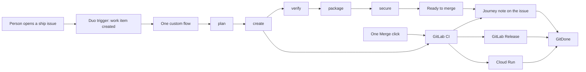

# GitDone

Small open-source and Web3 communities ship from a laptop, late, with no DevOps staff. The maintainer who answers Discord is also the person who tags the release. Changelogs live in commit messages. Scans run when someone remembers.

GitDone is the public face of a single [GitLab Duo Agent Platform](https://docs.gitlab.com/user/duo_agent_platform/) flow. A person opens one issue labelled `ship`. Agents plan, code, open the merge request, wait for the pipeline, package the image, and post a security note. They stop at **Ready to merge**. You approve with one click. The pipeline on the default branch publishes the GitLab Release, deploys when `GCP_DEPLOY` is true, and records who merged.

The name lives in one place: `PRODUCT_NAME` in [`src/config/brand.ts`](src/config/brand.ts). The mark — a branch with two commits that becomes a check — is defined in [`src/brand/mark.ts`](src/brand/mark.ts) and drawn in [`src/components/logo.tsx`](src/components/logo.tsx). Favicon, Apple touch icon, and Open Graph image are regenerated from that file with `node --experimental-strip-types scripts/render-brand.ts`.

This repository was created for the GitLab Transcend “Life After Code” hackathon (Path A). Day-1 on GitLab showed the category is **Supervised**: agents do everything up to the merge, and one human Merge click finishes the ship. GitLab blocks AI workflows from merging and from creating releases.

## Why Duo

A pipeline can build an image, scan it, and roll Cloud Run traffic back. It cannot notice a secret-detection finding at 02:14, open the merge request, patch the Dockerfile, wait for the pipeline, and write down what it did on the issue.

Without Duo Agent Platform that loop stops at the finding. Someone has to be awake to read the report and write the patch. GitDone’s agents do that work and stop at the merge request. The one click left is Merge. After that, `rollback-guard` can still shift traffic if a deploy degrades. One custom flow runs the stages up to Ready to merge. It does not call another flow, because GitLab does not allow that.

## Verify in 60 seconds

```bash
npm ci
npm test
npm run dev
```

Open [http://127.0.0.1:3847](http://127.0.0.1:3847). You should see the overnight path (finding, patched, checked, deployed, announced), the badge **Sample data**, and a link to the deploy that was sent back. Mission control shows a **Rollbacks** count. Nothing here calls GitLab until both `GITLAB_TOKEN` and `GITLAB_PROJECT_ID` are set.

## Built during the hackathon

Honest status, as of this commit:

- The Next.js app, the journey parser, the sample journeys, the tests, the Dockerfile, and the health check are real and run locally.
- Sample mode is this repository shipping itself, not a fictional product. The badge stays until GitDone is reading real journey notes from GitLab.
- The custom flow has run on GitLab. It planned, coded, opened a merge request, passed CI, and packaged with no human. Merge and release creation are blocked for AI workflows, so the flow now stops at Ready to merge and the pipeline publishes the release. See [`docs/capability-test.md`](docs/capability-test.md).
- The rollback decision in `src/lib/rollback-guard.ts` is tested. The Cloud Run traffic shift, the monitoring query, and `identity: google_cloud` are not, until the `rollback-guard` job runs.
- Announcement drafts are copy buttons. The flow does not post to X, Discord, or Telegram.

## How it works

1. Someone opens an issue from [`.gitlab/issue_templates/Ship.md`](.gitlab/issue_templates/Ship.md) and the template applies the `ship` label.
2. A Duo trigger on **Work item created** starts [`.gitlab/duo/flows/issue-to-production.yml`](.gitlab/duo/flows/issue-to-production.yml). One flow. It does not call another flow, because GitLab does not allow that.
3. The flow runs plan, create, verify, package, and secure. Secure always posts a journey note. The last component posts **Ready to merge** on the issue and the merge request, then stops. The note format is [`docs/journey-schema.md`](docs/journey-schema.md).
4. A person clicks Merge. [`ci/gitdone.gitlab-ci.yml`](ci/gitdone.gitlab-ci.yml) tests, runs SAST and secret detection on merge request pipelines too, builds the image, and on the default branch publishes the release with `CI_JOB_TOKEN`. When `GCP_DEPLOY` is `true` it deploys, smokes, and runs the rollback guard. `journey:record` posts the `approval` stage.
5. GitDone reads issues, merge requests, pipelines, releases, and the journey note. The release hub turns the release description into a changelog and drafts posts for X, Discord, and Telegram.

With `GITLAB_TOKEN` and `GITLAB_PROJECT_ID` unset, the app shows sample journeys of GitDone shipping this repository. The header badge says **Sample data**. Set both variables and the GitLab API is the only source.

## Stage coverage

| Stage | What the flow does | What GitDone shows |
| --- | --- | --- |
| Plan | Reads the issue. Writes acceptance checks, or asks one question if the issue is too vague. Skips issues without `ship`. | Plan summary |
| Create | Branch, commits, merge request that closes the issue. | MR link |
| Verify | Unit tests, lint, typecheck, then the merge request pipeline. Fixes failures on the same branch. | Test results |
| Package | Records the image the CI `package` job pushed to the GitLab registry. | Image reference |
| Secure | Reads SAST and secret detection on the merge request pipeline and always posts the journey note. | Findings found and resolved |
| Approval | The one human click. Recorded by the pipeline after merge, with who and when. | The one human touch |
| Release | The default-branch pipeline publishes a GitLab Release with `CI_JOB_TOKEN`. The flow does not. | Release link |
| Configure | Watches the Cloud Run production deploy of that image. | Deploy URL |
| Monitor | For five minutes after production deploy, check `/api/health` and the Cloud Run 5xx rate. The CI job `rollback-guard` does the same. | Guard result |
| Rollback | Only if the guard trips: shift traffic to the previous revision, post a `rollback` stage, reopen the issue. Govern does not announce that revision. | Distinct timeline state and a mission-control count |
| Govern | Final journey note: pipeline, findings, release, guard result, human-touch count. Drafts stay in GitDone. | Compliance evidence |

A supervised run records `humanTouches: 1` after the Merge click. A clarifying question in Plan is a second touch. The Ready to merge note still has `humanTouches: 0`, because the click has not happened yet.

## Architecture



The browser talks only to GitDone. GitDone talks to the GitLab REST API when the token is set. The flow talks to GitLab with the platform token (`GITLAB_TOKEN` inside the workload, sent as `Authorization: Bearer`). Those are different tokens.

## Run locally

Requires Node.js 22.

```bash
npm ci
npm run dev
```

Open [http://127.0.0.1:3847](http://127.0.0.1:3847). Demo mode needs no environment variables.

```bash
npm test
npm run lint
npm run typecheck
npm run build
npm start
npm run test:e2e
```

`npm start` listens on `$PORT` or 3000. The dev server and the e2e server use port 3847.

### Sample data

Leave `GITLAB_TOKEN` and `GITLAB_PROJECT_ID` unset. The project on screen is GitDone, path `gitdone/gitdone`, which is a stand-in until the real project path comes back from the API. You get the overnight security ship, one rollback, one in-flight issue, and earlier releases. Deploy links use `gitdone.example.com` and are marked sample URLs. The badge says **Sample data**.

### Live GitLab project

Copy [`.env.example`](.env.example).

| Variable | Required | Purpose |
| --- | --- | --- |
| `GITLAB_TOKEN` | with project id | Read access to the project. Sent as `Authorization: Bearer`. Not logged. |
| `GITLAB_PROJECT_ID` | with token | Numeric id, or a raw path such as `group/project`. |
| `GITLAB_BASE_URL` | no | Defaults to `https://gitlab.com`. |
| `SUBSCRIBE_WEBHOOK_URL` | no | `POST /api/subscribe` forwards `{ "email" }` here. Otherwise the address stays in the browser. |
| `GITLAB_OAUTH_CLIENT_ID` | to use OAuth | GitLab OAuth application. Scope `api`. Redirect `{origin}/api/connect/callback`. |
| `GITLAB_OAUTH_CLIENT_SECRET` | with the client id | Server only. Not logged. |
| `GITDONE_TOKEN_KEY` | to connect a project | 32-byte key, base64. Tokens are encrypted at rest. |
| `GITDONE_PUBLIC_URL` | no | Origin used for the OAuth redirect. Defaults to the request origin. |
| `GITDONE_CI_PROJECT` | no | Path whose `ci/gitdone.gitlab-ci.yml` install merge requests include. |
| `GITDONE_DATA_DIR` | no | SQLite directory. Defaults to `.data`. |

CI variables, set on the connected project:

| Variable | Required | Purpose |
| --- | --- | --- |
| `AST_ENABLE_MR_PIPELINES` | set in the include | `true` in `ci/gitdone.gitlab-ci.yml`, so SAST and secret detection run on merge request pipelines. |
| `GITDONE_NOTE_TOKEN` | no | Bearer token used only if `CI_JOB_TOKEN` cannot post the approval note. |
| `GCP_DEPLOY` | no | `true` includes deploy, smoke, and `rollback-guard`. Leave unset until Google Cloud is connected. |

Set both token and project id, or neither. One of them produces an error instead of silently showing sample data. Issues labelled `ship` are preferred once any exist. A journey note wins over inference.

The client reads, in order: project, issues, merge requests, releases, pipelines, then issue notes. A note that contains `<!-- journey:v1 { ... } -->` becomes the timeline. Without that note, stages are inferred from the MR, pipeline, and release, and the page says so. Responses are not cached, so the token is not stored in the Next.js fetch cache.

Health check for Cloud Run: `GET /api/health`.

RSS: `GET /feed.xml`.

## Sign in and deploy

People sign in with GitLab (OAuth authorization code and PKCE). Connected projects belong to that user. A signed-in Developer on the same GitLab project can open mission control. The public read-only page `/w/[id]` stays off until the owner publishes it. The landing page and `/mission` remain the GitDone showcase, readable without an account.

Render setup, including the OAuth application fields, is in [`docs/deploy-render.md`](docs/deploy-render.md).

## Deploy

The container is a Next.js standalone build. Cloud Run should set the container port to 8080 and the HTTP health check to `/api/health`.

```bash
docker build -t gitdone .
docker run --rm -p 8080:8080 -e PORT=8080 gitdone
```

GitLab CI, once this repo is on GitLab:

1. Enable the container registry.
2. Connect Google Cloud with Workload Identity Federation. Do not store a JSON key.
3. Replace the `REPLACE_WITH_*` variables in [`.gitlab-ci.yml`](.gitlab-ci.yml), or override them in CI/CD settings. Set `STAGING_SERVICE_URL` and `PRODUCTION_SERVICE_URL` to the Cloud Run URLs.
4. Push to the default branch. With `GCP_DEPLOY` unset, the pipeline lints, tests, runs SAST and secret detection, and builds the image. Set `GCP_DEPLOY` to `true` to copy the image, deploy, smoke `/api/health`, and run the rollback guard.
5. A merge to the default branch whose message contains `See merge request` publishes a GitLab Release with the CI job token, then `journey:record` posts the approval note. The flow does not create the release.

## Connect a project

Open `/connect`. Sign in with a GitLab OAuth app (`api` scope) or paste a token. GitDone checks Developer access and that Duo Agent Platform is enabled, then opens one merge request that adds the flow YAML, `AGENTS.md`, `skills/`, the `ship` label, the issue template, and a CI include of [`ci/gitdone.gitlab-ci.yml`](ci/gitdone.gitlab-ci.yml). Tokens stay on the server, encrypted with `GITDONE_TOKEN_KEY`. The public read-only workspace is `/w/<id>`.

The remaining steps are in GitLab: merge that request, enable the flow from the AI Catalog, and set CI variables. Deep links are on the done page.

## Duo Agent Platform

The flow has run. It stops before merge:

| Piece | Path |
| --- | --- |
| Repository instructions | [`AGENTS.md`](AGENTS.md) |
| Stage skills | [`skills/*/SKILL.md`](skills/) |
| Flow execution image, setup, cache, network | [`.gitlab/duo/agent-config.yml`](.gitlab/duo/agent-config.yml) |
| Issue-to-production flow | [`.gitlab/duo/flows/issue-to-production.yml`](.gitlab/duo/flows/issue-to-production.yml) |

Enablement, from the docs: a Maintainer pastes the flow YAML into **AI > Flows > New flow**, enables it on the project, and adds a trigger. The trigger to use is **Work item**, action **Created**. A mention trigger is a useful second condition for re-runs. The service account is created at enable time. `agent-config.yml` is read from the default branch only.

Custom flows define their own agents. They cannot call a custom agent from the AI Catalog, and one flow cannot trigger another. The stages through Ready to merge are components inside one file. There is no human-input component. The human step is the Merge button in GitLab, after the flow has stopped.

## Unverified

Checked against GitLab docs while writing. Not executed on GitLab.com.

- The flow YAML was saved in the AI Catalog and ran. The supervised rewrite is kept under the 40 KiB catalog limit. Re-save it after this change.
- The goal payload for **Work item created** is not specified on the schema page. Plan treats assign, mention, and a JSON iid. If none match, it stops.
- Flow tokens are limited to the `ai_workflows` scope. Merge returns 403 (`Quick actions merge cannot be used with AI workflows`, and the merge API). `POST /releases` is outside that scope. The flow stops and the pipeline does both jobs.
- Whether `gitlab_api_get` can read job traces or environment URLs was not confirmed. Configure records the deploy job when the public URL is missing.
- `id_tokens` appears in the flow-execution guide and not in the agent-config key table that was captured. It is omitted.
- The Google Cloud Run component repository was archived. The pipeline pins `@0.1.0`, which is the version in GitLab’s tutorial, including the `as` input used to name the two deploy jobs. Resolution of that tag was not tested.
- Playwright’s CI image tag `mcr.microsoft.com/playwright:v1.63.0-jammy` must match the installed `@playwright/test`. Confirm the tag exists before the first green pipeline.
- `STAGING_SERVICE_URL` is a placeholder. The tutorial does not show the component exporting the Cloud Run URL.
- `rollback-guard` uses `identity: google_cloud`, `gcloud run services update-traffic`, and `run.googleapis.com/request_count`. None of those calls have been executed. The job name `deploy-production` comes from the component `as` input, which is also unverified.
- The Monitor prompt timeout is 600 seconds so the five-minute window fits. The catalog schema’s upper bound was not checked.

## License

[MIT](LICENSE). Direct dependencies are MIT, Apache-2.0, BSD, or ISC. UI text uses Roboto and Roboto Mono (Apache-2.0) via `next/font`.
