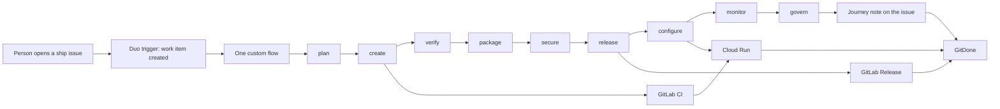

# GitDone

Small open-source and Web3 communities ship from a laptop, late, with no DevOps staff. The maintainer who answers Discord is also the person who tags the release. Changelogs live in commit messages. Scans run when someone remembers.

GitDone is the public face of a single [GitLab Duo Agent Platform](https://docs.gitlab.com/user/duo_agent_platform/) flow. A person opens one issue labelled `ship`. The flow carries it through all nine DevSecOps stages, deploys it, publishes a GitLab Release, and drafts the community post. The hub shows the changelog, the posts, and the journey.

The name lives in one place: `PRODUCT_NAME` in [`src/config/brand.ts`](src/config/brand.ts). The mark — a branch with two commits that becomes a check — is defined in [`src/brand/mark.ts`](src/brand/mark.ts) and drawn in [`src/components/logo.tsx`](src/components/logo.tsx). Favicon, Apple touch icon, and Open Graph image are regenerated from that file with `node --experimental-strip-types scripts/render-brand.ts`.

This repository was created for the GitLab Transcend “Life After Code” hackathon (Path A, hands-off). It is meant to be pushed to a public GitLab project under the MIT license. The pipeline and the Duo flow have not been executed yet. GitLab access for the hackathon was not available while this was written.

## How it works

1. Someone opens an issue from [`.gitlab/issue_templates/Ship.md`](.gitlab/issue_templates/Ship.md) and the template applies the `ship` label.
2. A Duo trigger on **Work item created** starts [`.gitlab/duo/flows/issue-to-production.yml`](.gitlab/duo/flows/issue-to-production.yml). One flow. It does not call another flow, because GitLab does not allow that.
3. Nine agents run in order. Each follows a skill in [`skills/`](skills/). Each posts a journey note on the issue. The note format is [`docs/journey-schema.md`](docs/journey-schema.md).
4. [`.gitlab-ci.yml`](.gitlab-ci.yml) tests, scans, builds the image, copies it to Artifact Registry, and deploys staging then production on Cloud Run.
5. GitDone reads issues, merge requests, pipelines, releases, and the journey note. The release hub turns the release description into a changelog and drafts posts for X, Discord, and Telegram.

With `GITLAB_TOKEN` and `GITLAB_PROJECT_ID` unset, the app serves a seeded project called keel so a judge can open it with no setup. The banner says **Demo data**.

## Stage coverage

| Stage | What the flow does | What GitDone shows |
| --- | --- | --- |
| Plan | Reads the issue. Writes acceptance checks, or asks one question if the issue is too vague. Skips issues without `ship`. | Plan summary |
| Create | Branch, commits, merge request that closes the issue. | MR link |
| Verify | Unit tests, lint, typecheck, then the merge request pipeline. Fixes failures on the same branch. | Test results |
| Package | Records the image the CI `package` job pushed to the GitLab registry. | Image reference |
| Secure | Triages SAST and secret detection. Patches findings on the branch. | Findings found and resolved |
| Release | Merges, tags, and publishes a GitLab Release whose description is the changelog. | Release link |
| Configure | Watches the Cloud Run production deploy of that image. | Deploy URL |
| Monitor | `GET /api/health` on the production URL. | Smoke result |
| Govern | Final journey note: pipeline, findings, release, smoke, human-touch count. Drafts stay in GitDone. | Compliance evidence |

A hands-off run records `humanTouches: 0`. The one-question pause in Plan is the only designed touch, and only when the issue does not say what “done” means.

## Architecture



The browser talks only to GitDone. GitDone talks to the GitLab REST API when the token is set. The flow talks to GitLab with the platform token (`GITLAB_TOKEN` inside the workload, sent as `Authorization: Bearer`). Those are different tokens.

## Run locally

Requires Node.js 22.

```bash
npm ci
npm run dev
```

Open [http://127.0.0.1:3847](http://127.0.0.1:3847). Demo mode needs no environment variables.

```bash
npm test
npm run lint
npm run typecheck
npm run build
npm start
npm run test:e2e
```

`npm start` listens on `$PORT` or 3000. The dev server and the e2e server use port 3847.

### Demo mode

Leave `GITLAB_TOKEN` and `GITLAB_PROJECT_ID` unset. The seeded project is keel, a volunteer-run session-receipt library. You get six issues (two live, four shipped), four releases, announcements, and metrics computed from those records. Deploy links use `keel.example.com` and are labelled as demo URLs.

### Live GitLab project

Copy [`.env.example`](.env.example).

| Variable | Required | Purpose |
| --- | --- | --- |
| `GITLAB_TOKEN` | with project id | Read access to the project. Sent as `Authorization: Bearer`. Not logged. |
| `GITLAB_PROJECT_ID` | with token | Numeric id, or a raw path such as `group/project`. |
| `GITLAB_BASE_URL` | no | Defaults to `https://gitlab.com`. |
| `SUBSCRIBE_WEBHOOK_URL` | no | `POST /api/subscribe` forwards `{ "email" }` here. Otherwise the address stays in the browser. |

Set both token and project id, or neither. One of them produces an error instead of silently showing demo data.

The client reads, in order: project, issues, merge requests, releases, pipelines, then issue notes. A note that contains `<!-- journey:v1 { ... } -->` becomes the timeline. Without that note, stages are inferred from the MR, pipeline, and release, and the page says so. Responses are not cached, so the token is not stored in the Next.js fetch cache.

Health check for Cloud Run: `GET /api/health`.

RSS: `GET /feed.xml`.

## Deploy

The container is a Next.js standalone build. Cloud Run should set the container port to 8080 and the HTTP health check to `/api/health`.

```bash
docker build -t gitdone .
docker run --rm -p 8080:8080 -e PORT=8080 gitdone
```

GitLab CI, once this repo is on GitLab:

1. Enable the container registry.
2. Connect Google Cloud with Workload Identity Federation. Do not store a JSON key.
3. Replace the `REPLACE_WITH_*` variables in [`.gitlab-ci.yml`](.gitlab-ci.yml), or override them in CI/CD settings. Set `STAGING_SERVICE_URL` and `PRODUCTION_SERVICE_URL` to the Cloud Run URLs.
4. Push to the default branch. The pipeline lints, tests, runs SAST and secret detection, builds the image, copies it to Artifact Registry, deploys staging, smokes `/api/health`, then deploys production.
5. A git tag runs the `release` job, which publishes a GitLab Release of this repository. That job is separate from the releases the flow creates for product changes.

## Duo Agent Platform

Drafts, not yet run:

| Piece | Path |
| --- | --- |
| Repository instructions | [`AGENTS.md`](AGENTS.md) |
| Stage skills | [`skills/*/SKILL.md`](skills/) |
| Flow execution image, setup, cache, network | [`.gitlab/duo/agent-config.yml`](.gitlab/duo/agent-config.yml) |
| Issue-to-production flow | [`.gitlab/duo/flows/issue-to-production.yml`](.gitlab/duo/flows/issue-to-production.yml) |

Enablement, from the docs: a Maintainer pastes the flow YAML into **AI > Flows > New flow**, enables it on the project, and adds a trigger. The trigger to use is **Work item**, action **Created**. A mention trigger is a useful second condition for re-runs. The service account is created at enable time. `agent-config.yml` is read from the default branch only.

Custom flows define their own agents. They cannot call a custom agent from the AI Catalog, and one flow cannot trigger another. That is why the nine stages are components inside one file, routed in order, with no human-input component on the happy path.

## Unverified

Checked against GitLab docs while writing. Not executed on GitLab.com.

- The flow YAML has not been saved in the AI Catalog, so schema validation beyond the documented fields is unproven. It is kept under the 40 KiB catalog limit.
- The goal payload for **Work item created** is not specified on the schema page. Plan treats assign, mention, and a JSON iid. If none match, it stops.
- Flow tokens are limited to the `ai_workflows` scope. Merge, Release, and some security-report endpoints may reject that token. The skills stop and record the 401 instead of claiming success.
- Whether `gitlab_api_get` can read job traces or environment URLs was not confirmed. Configure records the deploy job when the public URL is missing.
- `id_tokens` appears in the flow-execution guide and not in the agent-config key table that was captured. It is omitted.
- The Google Cloud Run component repository was archived. The pipeline pins `@0.1.0`, which is the version in GitLab’s tutorial, including the `as` input used to name the two deploy jobs. Resolution of that tag was not tested.
- Playwright’s CI image tag `mcr.microsoft.com/playwright:v1.63.0-jammy` must match the installed `@playwright/test`. Confirm the tag exists before the first green pipeline.
- `STAGING_SERVICE_URL` is a placeholder. The tutorial does not show the component exporting the Cloud Run URL.

## License

[MIT](LICENSE). Direct dependencies are MIT, Apache-2.0, BSD, or ISC. UI text uses Roboto and Roboto Mono (Apache-2.0) via `next/font`.
